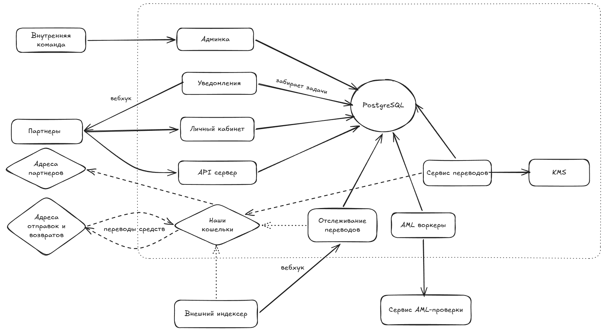
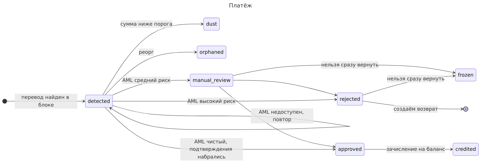
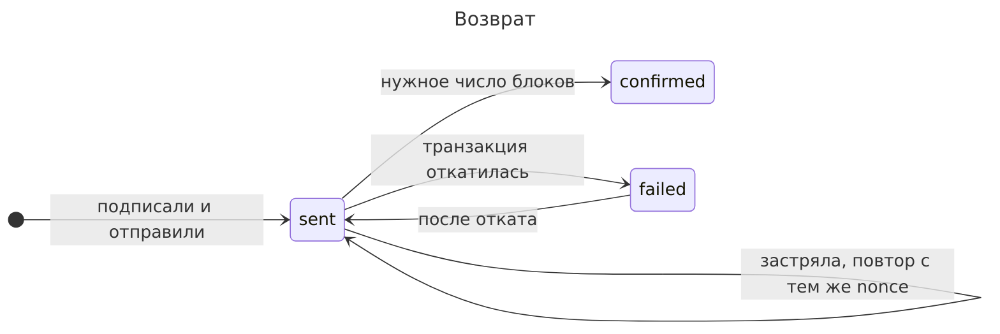

### 1.1 Элементы архитектуры

## API
Авторизация по ключу, выдаем его в кабинете. В базе храним хэш от него. Есть возможность временно иметь 2 ключа, чтобы партнер мог обновить ключ без даунтайма. Ключи принудительно обновляем редко, раз в 90 дней.
Эндпоинт POST /v1/invoice с телом из суммы; сроком действия инвойса. В заголовке Bearer ключ авторизации, Idempotency-Key - ключ заказа со стороны клиента, для минимизации риска создания дублирующих счетов. Если приходит тот же ключ с другим телом, то возвращаем ошибку 409. В ответ возвращаем адрес, сумму. 

## Счета
Будем иметь набор адресов для приема платежей. Для каждого счета будем выделять адрес из него, который будет привязан к нему какой-то период. После этого его можно переиспользовать. После истечения срока жизни адрес ещё какое-то время остаётся закреплён за этим счётом и не выдаётся новым: так ловим запоздавшие платежи, например вывод с биржи, который пришёл через несколько часов. Если по счету осталась недоплата, то можно переводить счет в статус paid_late, партнёр получает вебхук о позднем платеже и сам решает, выдавать ли товар/услугу или вернуть деньги. Если перевод пришёл уже после этого срока, либо счет уже оплачен полностью, (и адрес не привязан к новому счету) то перевод возвращаем (если он не санкционный).
Будем использовать смарт-контракты-форвардеры, адрес которых вычисляется через CREATE2. Газ за сбор платит служебный кошелёк (или пул), нет приватных ключей у адресов, можно делать свип пачкой. Комиссию на цепочке не делим: с депозитного адреса средства целиком уходят на наш кошелёк-сборщик, а комиссия — это проводка в ledger при зачислении на баланс партнёра. Сборщик и кошелёк для выплат разделяем. Плюс карантинный кошелек для возвратов "грязной" крипты. Сборщик мультисиг: он только принимает средства и по дневному лимиту пополняет горячий кошелёк. Выплаты партнёрам идут с горячего кошелька, на котором лежит запас на несколько часов выплат; ключ от него и карантинного храним в KMS. Так при утечке ключа под угрозой только этот запас, а не все накопленные средства. 
## Отслеживание входящих переводов
Внешний индексер + собственный сканер блоков (можно начинать только с внешним индексером).
###### Что не учитываем и игнорируем
Смотрим события только с контрактом с адресом `0xdAC17F95…1ec7`, так мы защищены от подделки USDT. Также проверяем статус транзакции, чтобы он был успешным. Если на адрес приходит пыль - ничего не делаем и не инициируем проверки.
## AML
AML-сервис в начале точно используем сторонний. Это сложный в реализации и высокорисковый поддомен. Его есть смысл заменять при неудовлетворительном качестве услуг провайдера (false positives/negatives), слишком больших расходах и/или задержках (из-за того, что провайдер обслуживает не только нас). Считаем, что оплата идет раз в месяц и не участвует в системе для простоты (иначе просто завели бы счет в ledger). Кроме входящих переводов обязательно проверяем адреса назначения возвратов и адреса выплат партнёров. 
## Зачисление **и выплата** средств
Зачисление — это проводка в ledger: после AML сумма за вычетом комиссии попадает на баланс партнёра. Выплата партнёру на адрес из кабинета идёт, например, при достижении порога баланса или по запросу через API.  Перевод средств с баланса на кошелек партнера: сначала записываем хэш транзакции и получаем nonce, записываем их в БД, совершаем отправку этой транзакции и отслеживаем ее. 
Этим же образом осуществляем и возврат средств (но уже с карантинного кошелька). Возвраты по инициативе партнёра (например, переплата или отмена заказа) можно поддержать тем же механизмом со списанием с баланса партнёра.
## Уведомления
Партнеров будем уведомлять с помощью вебхуков. При этом также предоставим API-эндпоинт для получения всех уведомлений за какой-то период `GET /v1/events?starting_after=…`. Для уведомления критична ALO гарантия, но не EO. Поэтому можно отправлять уведомление, и при успешной отправке обновлять запись в БД. Подписывать будем с Ed25519. В уведомлении содержится в том числе адрес счета, так что партнер сможет легко дедуплицировать повторные уведомления. 
Точно уведомляем о следующих событиях: успешное зачисление на баланс партнера, выплата партнёру, истечение счета, поздний платёж по истёкшему счёту (если поддерживаем). Очень вероятно, что и просто процесс оплаты счета (если один перевод не закрывает его). Все остальное можно оставить на настройки партнера в его личном кабинете.
## Рост до 1 млн счетов в день
При миллионе переводов в сутки даже 1% среднего риска — это ~12 тыс. ручных разборов в день, столько compliance не разберёт. Нужно будет отсеивать все суммы до какого-то порога. 
И в БД начнут появляться горячие строки балансов, и будут сильно раздуваться таблицы задач. Для первого будем делить такие строки на бакеты и сливать. Для второго удалять старые партиции по дням.

### 1.2. Деньги

###### Статусы платежа

###### Счета в ledger
Счета делятся на три группы. Первая (custody) — где лежат средства: deposits, collector, hot, quarantine, gas sponsor, gas quarantine. Вторая группа — что мы должны другим. Партнерские on_hold (деньги с ожиданием вердикта AML, попадают после подтверждения транзакции), available (на балансе), payout_pending (выплата отправлена) и общие refund_pending (долг по отклоненным платежам), frozen. Третья - наши средства: revenue fees, expense gas.
###### Проводки
**Обычный платёж с комиссией.** Перевод набирает нужное число подтверждений, дебетуем `custody:deposits` и кредитуем `partner:P:on_hold`. Чистый вердикт AML зачисляет платёж: дебетуем `partner:P:on_hold`, кредитуем `partner:P:available` на сумму без нашей комиссии и `revenue:fees` на нашу комиссию. После этого партнёр видит деньги на балансе.
После подтверждения свипа дебетуем `custody:collector` и кредитуем `custody:deposits`.  Пополнение горячего кошелька отражаем дебетом `custody:hot` и кредитом `custody:collector`.
Когда партнёр выводит деньги, дебетуем `partner:P:available` и кредитуем `partner:P:payout_pending` на сумму выплаты. После подтверждения дебетуем `partner:P:payout_pending` и кредитуем `custody:hot`. 
**Платёж на AML-проверке.** Пока нет вердикта, проводок нет. Проводки до момента проверки и после успеха описаны выше. Если вердикт "санкции", дебетуем `partner:P:on_hold` и кредитуем `frozen`, а средства остаются на депозитном адресе до решения compliance.
**Возврат.** Когда AML отклоняет платёж, дебетуем `partner:P:on_hold` и кредитуем `refund_pending`.После свипа в каратин дебетуем `custody:quarantine` и кредитуем `custody:deposits`. После возврата дебетуем `refund_payable` и кредитуем `custody:quarantine`.
###### Газ для возврата
 Газ переводов идёт дебетом `expense:gas` и кредитом `gas:sponsor` или `gas:quarantine` в ETH. Газ за сбор с форвардера в карантин платит служебный кошелёк, а сам возврат отправляет карантинный кошелёк, на котором ETH есть. Газ оплачиваем из своих средств и закладываем его в фиксированную часть комиссии, чтобы не забирать "грязную" крипту.

### 1.3. Продуктовые вопросы

1. **Клиент недоплатил 3%** Ставим какой-то порог недоплаты (и даем его настроить партнеру), после которой при истечении срока счета переводим деньги и помечаем его как частично оплаченный. Можем посылать партнеру вебхуки по мере пополнения счета (ожидалось, получено, осталось). 
2. **AML отклонил платёж**. Описано в разделе AML
3. **Комиссия скорее тариф из фикса + процента**. Фиксированная часть нужна, чтобы покрывать расходы, которые не сильно зависят от суммы, вроде газа. Процент зависит от клиента, зависит от того, кого привлекаем и как. В начале может быть меньше комиссия у клиента с большим объемом (для привлечения), а после развития сервиса больше (чтобы компенсировать траты на масштабирование под нагрузку). В ledger комиссия — отдельная строка каждого зачисления и в вычете из баланса фикса, со ссылками на использованный тариф (в отдельной таблице). Клиент отдельно видит фикс. часть и процент от суммы.
4. **Метрики**
	1. Партнёр видит оборот (оплачено, комиссия, зачислено), чтобы сверяться со своей бухгалтерией, и баланс (доступно, на проверке, в выплате), чтобы знать, что можно вывести. Он также видит порог, по которому выводится сумма. Кроме того, ему показываем конверсию «счёт → оплата» и время от перевода до зачисления, чтобы он мог сверить SLO сервиса с фактом для него. Кроме того позволяем увидеть долю недоплат и отказов AML с детализацией по его счетам, чтобы он мог видеть проблемных клиентов.
	2. В админке смотрим общий оборот и выручку сервиса — то, сколько мы зарабатываем, — а также юнит-экономику одного платежа: комиссия против газа и стоимости AML, потому что при росте она может сломаться первой. Отслеживаем число активных партнёров и долю крупнейших, чтобы видеть зависимость от отдельных клиентов. Конверсию «счёт → оплата», время до зачисления и долю отказов AML сравниваем по партнёрам. 
5. **MVP**: выпускаем то, от чего зависит корректность денег: Ledger, EOA-адреса с ETH на них для в качестве пула адресов, внешний индексер платежей для подтверждений, внешний AML, ledger, API-эндпоинт с выдачей счетов и минималистичный личный кабинет с выдачей ключа (или выдаем их вручную при первой обкатке). Выплаты по запросу через API или вручную. Строгость в переводах и ledger критичны, а часть логики в первое время может поработать в ручном режиме.

### 1.4. Журнал решений

###### Сканер блоков, а не подписки на события в блокчейне
Если вебсокет потеряет подключение, мы все это время будем не получать события, то есть это новая точка отказа, а со сканером блоков такого нет. 
###### Почему и внешний индексер, и свой сканер блоков
Провайдеры указывают SLA от 99.99% до 99.995%, плюс часты задержки. Чтобы улучшить SLA (и SLO), используем также свое сканирование блоков. Плюс ноды могут возвращать неверный ответ, поэтому перестраховываемся с внешним индексером.
###### Подтверждение и AML-проверка параллельно, а не последовательно
Согласно Etherscan реорги на 1 блок это 0.1 процент от всех блоков. Таким образом, можно сразу запускать AML-проверку для всех переводов для скорости. В зависимости от суммы ждем 5 блоков (зависит от времени AML) или до финализации.
###### Тип кошельков для депозитов
Сначала выбрал EOA, потом EIP-7702. Выбрал форвардеры. У EIP-7702 первое использование дешевле и логику можно обновить, но у каждого адреса остаётся приватный ключ. Проблемы с EOA описал в разделе про счета.
###### Postgres для событий
А не брокер сообщений. Даже при росте до 1млн счетов в сутки хватит инстанса (и нет внешних потребителей), и при этом можем атомарно добавлять записи в лог и обновлять статусы. При дальнейшем масштабировании можно шардировать по какому-то идентификатору партнера в зависимости от его размера, и выделять отдельные пулы адресов на партнеров.
